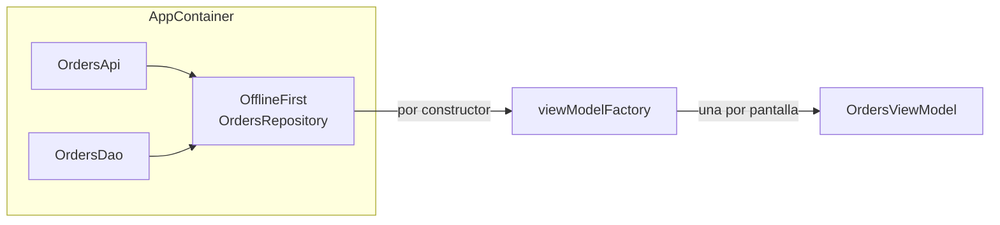

# 1.2 · DI manual: constructor, contenedor y fábricas

## Objetivos

> **En una frase:** una clase declara en su constructor lo que necesita, y otra pieza (el contenedor) decide qué instancias recibe y cuánto viven.

Al terminar podrás:

- Construir el grafo de dependencias a mano con un contenedor de aplicación.
- Distinguir la inyección por constructor de un service locator.
- Probar un ViewModel con un fake, sin red ni base de datos.

**Bloques:** 1. 📖 Dependencias ocultas → 🛠 extraer `OrdersRepository` → ❓ 2 preguntas · 2. 📖 El contenedor y el tiempo de vida → 🛠 crear `AppContainer` → ❓ 2 preguntas · 3. 🛠 probar el ViewModel con un fake → ❓ comprobación de dominio

## 📖 Teoría · 1. Dependencias ocultas y constructor

**El problema.** Si `OrdersViewModel` crea dentro de sí mismo su repositorio, queda atado a esa implementación: no puedes pasarle un fake en un test ni cambiar la fuente de datos sin tocar su código.

**La idea.** La clase *declara* lo que necesita como parámetros del constructor y alguien de fuera se lo entrega. Eso es la **inyección de dependencias (DI)**, una forma concreta de **inversión de control**.

- **Dependencia:** objeto que una clase necesita para cumplir su función.
- **Inyección por constructor:** las dependencias llegan como parámetros; la clase no sabe cómo se crearon.
- **Service locator:** la clase *pide* sus dependencias a un registro global. Oculta lo que necesita y complica los tests.

> [!TIP]
> Analogía: un restaurante no cultiva sus tomates; los recibe de un proveedor. Cambiar de proveedor no obliga a cambiar la receta.

**Ejemplo mínimo** (fuera del proyecto)

```kotlin
// Antes: la dependencia está oculta dentro de la clase
class Report {
    private val clock = SystemClock()
    fun title() = "Informe ${clock.today()}"
}

// Después: se declara y se recibe
class Report(private val clock: Clock) {
    fun title() = "Informe ${clock.today()}"
}
```

**En tu proyecto**

```kotlin
// :feature:orders/OrdersRepository.kt
interface OrdersRepository {
    suspend fun orders(): List<Order>
}

class OfflineFirstOrdersRepository(
    private val api: OrdersApi,
    private val dao: OrdersDao,
) : OrdersRepository {
    override suspend fun orders(): List<Order> =
        try {
            api.fetchOrders().also { dao.upsertAll(it) }
        } catch (e: IOException) {
            dao.getAll() // sin red: se sirve la caché local
        }
}
```

**Lo que sale mal**

Si en vez del constructor usas `lateinit var` y olvidas asignarlo, el fallo no aparece al compilar sino en ejecución:

```text
kotlin.UninitializedPropertyAccessException:
  lateinit property repository has not been initialized
```

Con el constructor, el compilador te obliga a pasar la dependencia: el error se adelanta al build.

## 🛠 Práctica · 1. Extraer la interfaz del repositorio

### 🧩 Reto 1 · `OrdersViewModel` sin dependencias ocultas

Haz que `OrdersViewModel` reciba el repositorio en lugar de crearlo:

1. Crea la interfaz `OrdersRepository` en `:feature:orders`.
2. Renombra la clase actual a `OfflineFirstOrdersRepository` y haz que la implemente.
3. Cambia `OrdersViewModel` para que reciba un `OrdersRepository`.

**Resultado esperado**

```text
$ ./gradlew :feature:orders:compileDebugKotlin
BUILD SUCCESSFUL
```

Y ninguna llamada a `OfflineFirstOrdersRepository(...)` dentro de `OrdersViewModel`.

<details>
<summary>Pista 1</summary>

¿Qué tendría que cambiar en la firma de `OrdersViewModel` para que un test pudiera pasarle otra implementación?

</details>

<details>
<summary>Pista 2</summary>

Un parámetro del constructor con el tipo de la interfaz. Evita `lateinit var`: el compilador no te obligaría a asignarlo.

</details>

<details>
<summary>Solución</summary>

```kotlin
// :feature:orders/OrdersViewModel.kt
class OrdersViewModel(
    private val repository: OrdersRepository,
) : ViewModel()
```

</details>

**Tu intento:** primero con `lateinit var repository`, que compiló pero cerró la pantalla con `UninitializedPropertyAccessException`; después, por constructor. · **Veredicto:** ✔ resuelto en la pista 2

## ❓ Preguntas · 1. Dependencias y constructor

**P1.** ¿Por qué un service locator dificulta los tests aunque también separe la creación de objetos? — tu respuesta: *«porque no ves qué necesita la clase»* ✔

<details>
<summary>Respuesta completa</summary>

Las dependencias no aparecen en la firma de la clase: el test tiene que saber qué registrar en el localizador global y limpiar ese estado entre tests. Con inyección por constructor, el compilador te obliga a pasar cada dependencia.

</details>

**Para ampliar:** el nombre habitual del problema es «dependencias implícitas»; el síntoma típico es un test que pasa solo si se ejecuta después de otro.

**P2.** En tu proyecto, ¿qué gana `OrdersViewModel` al recibir `OrdersRepository` en lugar de `OfflineFirstOrdersRepository`? — tu respuesta: *«puedo pasarle un fake»* ✔

<details>
<summary>Respuesta completa</summary>

Depende de una abstracción: en tests recibe un fake y en producción la implementación real. Además, cambiar la implementación (otra API, otra base de datos) no obliga a tocar el ViewModel.

</details>

## 📖 Teoría · 2. El contenedor decide cuánto vive cada objeto

Alguien tiene que construir el grafo. Ese «alguien» es el **contenedor**: sabe crear cada objeto y decide su **tiempo de vida**. Los objetos de vida corta (los ViewModels) se crean con una **fábrica**, no se guardan en el contenedor.



**Ejemplo mínimo** (fuera del proyecto)

```kotlin
class Container {
    // una sola instancia mientras viva el contenedor
    val clock: Clock by lazy { SystemClock() }
}
```

**En tu proyecto**

```kotlin
// :app/AppContainer.kt
class AppContainer(context: Context) {
    private val api: OrdersApi by lazy { NetworkFactory.ordersApi() }
    private val dao: OrdersDao by lazy {
        AppDatabase.get(context).ordersDao()
    }
    val ordersRepository: OrdersRepository by lazy {
        OfflineFirstOrdersRepository(api, dao)
    }
}
```

```kotlin
// :app/OrdersViewModelFactory.kt
// import …AndroidViewModelFactory.Companion.APPLICATION_KEY
val ordersViewModelFactory = viewModelFactory {
    initializer {
        val app = this[APPLICATION_KEY] as OrdersApp
        OrdersViewModel(app.container.ordersRepository)
    }
}
```

**Lo que sale mal**

Crear el contenedor en cada Activity parece inofensivo, pero abre una base de datos por pantalla y la caché deja de compartirse. En el emulador se ve como datos que «no se actualizan» al volver atrás. El contenedor vive en la `Application`.

## 🛠 Práctica · 2. Crear `AppContainer` y la fábrica

### 🧩 Reto 2 · Un contenedor para toda la app

Construye el grafo a mano: `AppContainer` en `:app`, expuesto desde `OrdersApp`, y una fábrica que cree `OrdersViewModel` con el repositorio del contenedor. Úsala en la pantalla con `viewModel(factory = …)`.

**Resultado esperado**

La lista de pedidos carga en el emulador y la única llamada a `OfflineFirstOrdersRepository(...)` está dentro de `AppContainer`.

<details>
<summary>Pista 1</summary>

¿Qué objetos deben vivir mientras viva la app y cuáles se crean uno por pantalla?

</details>

<details>
<summary>Pista 2</summary>

Los de vida larga, como propiedades `by lazy` del contenedor; el ViewModel, con `viewModelFactory { initializer { … } }`, leyendo el contenedor desde `APPLICATION_KEY`.

</details>

<details>
<summary>Solución</summary>

Es el código de «En tu proyecto» del bloque 📖 2: `AppContainer` con `by lazy` y `ordersViewModelFactory` con `initializer`.

</details>

**Tu intento:** funcionó a la primera; en la revisión cambiamos el tipo expuesto de `OfflineFirstOrdersRepository` a `OrdersRepository`. · **Veredicto:** ✔ resuelto sin pistas

## ❓ Preguntas · 2. Contenedor y fábricas

**P3.** Además de qué implementación usar, ¿qué decide el contenedor? — tu respuesta: *«cuándo se crea»* ✔

<details>
<summary>Respuesta completa</summary>

El **tiempo de vida**: con `by lazy` hay una sola instancia mientras viva la `Application`; la fábrica crea un ViewModel nuevo por pantalla.

</details>

**Para ampliar:** eso es exactamente lo que en Hilt se llamará *scope*: `@Singleton`, `@ActivityRetainedScoped`, `@ViewModelScoped`.

**P4.** ¿Qué problema aparece si pasas el `AppContainer` entero a `OrdersViewModel`? — tu respuesta: *«ninguno, es más cómodo»* ✘

<details>
<summary>Respuesta completa</summary>

Vuelve a ser un service locator: el ViewModel puede pedir cualquier cosa y su firma deja de decir qué necesita. Pasa solo el repositorio.

</details>

**Para ampliar:** la regla práctica es «pasa dependencias, no contenedores».

## 🛠 Práctica · 3. Un test con fake

### 🧩 Reto 3 · Probar el ViewModel sin red ni base de datos

Escribe `FakeOrdersRepository` y un `OrdersViewModelTest` que compruebe que la pantalla expone los pedidos del repositorio.

**Resultado esperado**

```text
$ ./gradlew :feature:orders:test
4 tests completed, 0 failed
```

<details>
<summary>Pista 1</summary>

El fake implementa `OrdersRepository` y devuelve una lista fija que el test conoce.

</details>

<details>
<summary>Solución</summary>

```kotlin
class FakeOrdersRepository(
    private val data: List<Order>,
) : OrdersRepository {
    override suspend fun orders() = data
}

@Test
fun `expone los pedidos del repositorio`() = runTest {
    val repo = FakeOrdersRepository(listOf(sampleOrder))
    val viewModel = OrdersViewModel(repo)
    assertEquals(listOf(sampleOrder), viewModel.state.value.orders)
}
```

</details>

**Tu intento:** el fake a la primera; el test solo comprobaba que el estado no fuera nulo. · **Veredicto:** ✔ resuelto tras la mutación (abajo)

> [!NOTE]
> Comprobamos el test con una mutación: al devolver `emptyList()` en el repositorio real, el test seguía pasando porque solo comprobaba que el estado no fuera nulo. Lo cambiaste para comparar la lista y entonces falló, como debía.

## ❓ Preguntas · 3. Comprobación de dominio

**P5.** En este cambio, `OfflineFirstOrdersRepository` crea su propio `OrdersDao` en lugar de recibirlo. ¿Qué problemas introduce? — tu respuesta: *«vuelve la dependencia oculta y no puedo cambiar la BD en tests»* ✔

```kotlin
class OfflineFirstOrdersRepository(
    private val api: OrdersApi,
    context: Context,
) : OrdersRepository {
    private val dao = AppDatabase.get(context).ordersDao()
    // …
}
```


<details>
<summary>Respuesta completa</summary>

Reaparece la dependencia oculta: no se puede sustituir la base de datos en los tests y podrían abrirse dos instancias de Room con configuraciones distintas.

</details>

**P6.** Explícame con tus palabras qué hace el contenedor. (Ver «Resumen con tus palabras».)

## Resumen con tus palabras

> «Las clases piden lo que necesitan por constructor y el `AppContainer` arma todo una sola vez al arrancar. En los tests paso fakes y la app real usa Retrofit y Room. Hilt va a generar ese contenedor por mí.»

Corrección: añadimos que el contenedor también decide el tiempo de vida, no solo la implementación.

## Fuentes

- [Inyección de dependencias manual](https://developer.android.com/training/dependency-injection/manual) — Android Developers, consultado 2026-09.
- [Inyección de dependencias en Android](https://developer.android.com/training/dependency-injection) — conceptos y alternativas.
- [Crear ViewModels con dependencias](https://developer.android.com/topic/libraries/architecture/viewmodel/viewmodel-factories) — `viewModelFactory` e `initializer`.

## Historial

| Fecha | Qué pasó |
|---|---|
| 2026-09-15 | Lección iniciada. Bloques 1 y 2 completados. |
| 2026-09-15 | Atasco en la práctica 1 (usó `lateinit var`); resuelto en la pista 2. |
| 2026-09-15 | P4 fallada: «pasar el contenedor entero». Se explicó con un ejemplo distinto y quedó clara. |
| 2026-09-15 | Mutación del repositorio: el test pasaba con un `assert` débil; corregido. |
| 2026-09-15 | Lección completada: 5 de 6 preguntas correctas y los tres retos resueltos. |
