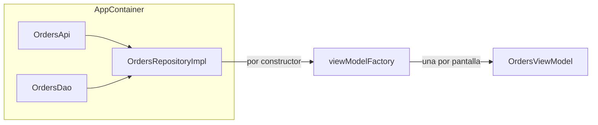

# 1.2 · DI manual: constructor, contenedor y fábricas

## Resumen

> **En una frase:** una clase declara en su constructor lo que necesita, y otra pieza (el contenedor) decide qué instancias recibe y cuánto viven.

**Resultado esperado:** construir el grafo de dependencias a mano con un contenedor de aplicación.

**Bloques de esta lección**

1. 📖 Dependencias ocultas → 🛠 extraer `OrdersRepository` → ❓ 2 preguntas
2. 📖 El contenedor y el tiempo de vida → 🛠 crear `AppContainer` → ❓ 2 preguntas
3. 🛠 probar el ViewModel con un fake → ❓ comprobación de dominio

## 📖 Teoría · 1. Dependencias ocultas y constructor

**El problema.** Si `OrdersViewModel` crea dentro de sí mismo su repositorio, queda atado a esa implementación: no puedes pasarle un fake en un test ni cambiar la fuente de datos sin tocar su código.

**La idea.** La clase *declara* lo que necesita como parámetros del constructor y alguien de fuera se lo entrega. Eso es la **inyección de dependencias (DI)**, una forma concreta de **inversión de control**.

- **Dependencia:** objeto que una clase necesita para cumplir su función.
- **Inyección por constructor:** las dependencias llegan como parámetros; la clase no sabe cómo se crearon.
- **Service locator:** la clase *pide* sus dependencias a un registro global. Oculta lo que necesita y complica los tests.

> [!TIP]
> Analogía: un restaurante no cultiva sus tomates; los recibe de un proveedor. Cambiar de proveedor no obliga a cambiar la receta.

**Ejemplo mínimo** (fuera del proyecto)

```kotlin
// Antes: la dependencia está oculta dentro de la clase
class Report {
    private val clock = SystemClock()
    fun title() = "Informe ${clock.today()}"
}

// Después: se declara y se recibe
class Report(private val clock: Clock) {
    fun title() = "Informe ${clock.today()}"
}
```

**En tu proyecto**

```kotlin
// :feature:orders/OrdersRepository.kt
interface OrdersRepository {
    suspend fun orders(): List<Order>
}

class OrdersRepositoryImpl(
    private val api: OrdersApi,
    private val dao: OrdersDao,
) : OrdersRepository {
    override suspend fun orders(): List<Order> =
        try {
            api.fetchOrders().also { dao.upsertAll(it) }
        } catch (e: IOException) {
            dao.getAll() // sin red: se sirve la caché local
        }
}
```

**Lo que sale mal**

Si en vez del constructor usas `lateinit var` y olvidas asignarlo, el fallo no aparece al compilar sino en ejecución:

```text
kotlin.UninitializedPropertyAccessException:
  lateinit property repository has not been initialized
```

Con el constructor, el compilador te obliga a pasar la dependencia: el error se adelanta al build.

## 🛠 Práctica · 1. Extraer la interfaz del repositorio

1. Crea `OrdersRepository` (interfaz) en `:feature:orders`.
2. Renombra la clase actual a `OrdersRepositoryImpl` y haz que implemente la interfaz.
3. Cambia `OrdersViewModel` para recibir `OrdersRepository` por constructor.
4. Ejecuta `./gradlew :feature:orders:compileDebugKotlin`.

- **Criterio de éxito:** compila y `OrdersViewModel` no crea ninguna dependencia.
- **Lo que observaste:** compiló a la segunda; la primera vez quedó un `lateinit var repository` sin asignar y la pantalla se cerró con `UninitializedPropertyAccessException`.

## ❓ Preguntas · 1. Dependencias y constructor

**P1.** ¿Por qué un service locator dificulta los tests aunque también separe la creación de objetos? — tu respuesta: *«porque no ves qué necesita la clase»* ✔

<details>
<summary>Respuesta completa</summary>

Las dependencias no aparecen en la firma de la clase: el test tiene que saber qué registrar en el localizador global y limpiar ese estado entre tests. Con inyección por constructor, el compilador te obliga a pasar cada dependencia.

</details>

**Para ampliar:** el nombre habitual del problema es «dependencias implícitas»; el síntoma típico es un test que pasa solo si se ejecuta después de otro.

**P2.** En tu proyecto, ¿qué gana `OrdersViewModel` al recibir `OrdersRepository` en lugar de `OrdersRepositoryImpl`? — tu respuesta: *«puedo pasarle un fake»* ✔

<details>
<summary>Respuesta completa</summary>

Depende de una abstracción: en tests recibe un fake y en producción la implementación real. Además, cambiar la implementación (otra API, otra base de datos) no obliga a tocar el ViewModel.

</details>

## 📖 Teoría · 2. El contenedor decide cuánto vive cada objeto

Alguien tiene que construir el grafo. Ese «alguien» es el **contenedor**: sabe crear cada objeto y decide su **tiempo de vida**. Los objetos de vida corta (los ViewModels) se crean con una **fábrica**, no se guardan en el contenedor.



**Ejemplo mínimo** (fuera del proyecto)

```kotlin
class Container {
    // una sola instancia mientras viva el contenedor
    val clock: Clock by lazy { SystemClock() }
}
```

**En tu proyecto**

```kotlin
// :app/AppContainer.kt
class AppContainer(context: Context) {
    private val api: OrdersApi by lazy { NetworkFactory.ordersApi() }
    private val dao: OrdersDao by lazy {
        AppDatabase.get(context).ordersDao()
    }
    val ordersRepository: OrdersRepository by lazy {
        OrdersRepositoryImpl(api, dao)
    }
}
```

```kotlin
// :app/OrdersViewModelFactory.kt
// import …AndroidViewModelFactory.Companion.APPLICATION_KEY
val ordersViewModelFactory = viewModelFactory {
    initializer {
        val app = this[APPLICATION_KEY] as OrdersApp
        OrdersViewModel(app.container.ordersRepository)
    }
}
```

**Lo que sale mal**

Crear el contenedor en cada Activity parece inofensivo, pero abre una base de datos por pantalla y la caché deja de compartirse. En el emulador se ve como datos que «no se actualizan» al volver atrás. El contenedor vive en la `Application`.

## 🛠 Práctica · 2. Crear `AppContainer` y la fábrica

1. Añade `AppContainer` en `:app` y expónlo desde `OrdersApp`.
2. Crea la fábrica del ViewModel con `viewModelFactory { initializer { … } }`.
3. Usa `viewModel(factory = ordersViewModelFactory)` en la pantalla.
4. Ejecuta la app y abre la lista de pedidos.

- **Criterio de éxito:** la pantalla carga pedidos y no hay ninguna llamada a `OrdersRepositoryImpl(...)` fuera del contenedor.
- **Lo que observaste:** funcionó; en la revisión cambiamos el tipo expuesto de `OrdersRepositoryImpl` a `OrdersRepository`.

## ❓ Preguntas · 2. Contenedor y fábricas

**P3.** Además de qué implementación usar, ¿qué decide el contenedor? — tu respuesta: *«cuándo se crea»* ✔

<details>
<summary>Respuesta completa</summary>

El **tiempo de vida**: con `by lazy` hay una sola instancia mientras viva la `Application`; la fábrica crea un ViewModel nuevo por pantalla.

</details>

**Para ampliar:** eso es exactamente lo que en Hilt se llamará *scope*: `@Singleton`, `@ActivityRetainedScoped`, `@ViewModelScoped`.

**P4.** ¿Qué problema aparece si pasas el `AppContainer` entero a `OrdersViewModel`? — tu respuesta: *«ninguno, es más cómodo»* ✘

<details>
<summary>Respuesta completa</summary>

Vuelve a ser un service locator: el ViewModel puede pedir cualquier cosa y su firma deja de decir qué necesita. Pasa solo el repositorio.

</details>

**Para ampliar:** la regla práctica es «pasa dependencias, no contenedores».

## 🛠 Práctica · 3. Un test con fake

1. Crea `FakeOrdersRepository` en los tests de `:feature:orders`.
2. Escribe `OrdersViewModelTest` sin red ni base de datos.

```kotlin
class FakeOrdersRepository(
    private val data: List<Order>,
) : OrdersRepository {
    override suspend fun orders() = data
}

@Test
fun `expone los pedidos del repositorio`() = runTest {
    val repo = FakeOrdersRepository(listOf(sampleOrder))
    val viewModel = OrdersViewModel(repo)
    // comprobar el estado que expone el ViewModel
}
```

- **Criterio de éxito:** `./gradlew :feature:orders:test` pasa sin red.
- **Lo que observaste:** 4 tests pasan en 1,2 s.

> [!NOTE]
> Comprobamos el test con una mutación: al devolver `emptyList()` en el repositorio real, el test seguía pasando porque solo comprobaba que el estado no fuera nulo. Lo cambiaste para comparar la lista y entonces falló, como debía.

## ❓ Preguntas · 3. Comprobación de dominio

**P5.** Predice: ¿qué pasa si `OrdersRepositoryImpl` crea su propio `OrdersDao`? — tu respuesta: *«vuelve la dependencia oculta y no puedo cambiar la BD en tests»* ✔

<details>
<summary>Respuesta completa</summary>

Reaparece la dependencia oculta: no se puede sustituir la base de datos en los tests y podrían abrirse dos instancias de Room con configuraciones distintas.

</details>

**P6.** Explícame con tus palabras qué hace el contenedor. (Ver «Resumen con tus palabras».)

## Resumen con tus palabras

> «Las clases piden lo que necesitan por constructor y el `AppContainer` arma todo una sola vez al arrancar. En los tests paso fakes y la app real usa Retrofit y Room. Hilt va a generar ese contenedor por mí.»

Corrección: añadimos que el contenedor también decide el tiempo de vida, no solo la implementación.

## Fuentes

- [Inyección de dependencias manual](https://developer.android.com/training/dependency-injection/manual) — Android Developers, consultado 2026-09.
- [Inyección de dependencias en Android](https://developer.android.com/training/dependency-injection) — conceptos y alternativas.
- [Crear ViewModels con dependencias](https://developer.android.com/topic/libraries/architecture/viewmodel/viewmodel-factories) — `viewModelFactory` e `initializer`.

## Historial

| Fecha | Qué pasó |
|---|---|
| 2026-09-15 | Lección iniciada. Bloques 1 y 2 completados. |
| 2026-09-15 | Atasco en la práctica 1 (usó `lateinit var`); resuelto en la pista 2. |
| 2026-09-15 | P4 fallada: «pasar el contenedor entero». Se explicó con un ejemplo distinto y quedó clara. |
| 2026-09-15 | Mutación del repositorio: el test pasaba con un `assert` débil; corregido. |
| 2026-09-15 | Lección completada: 5 de 6 preguntas correctas y práctica funcionando. |
