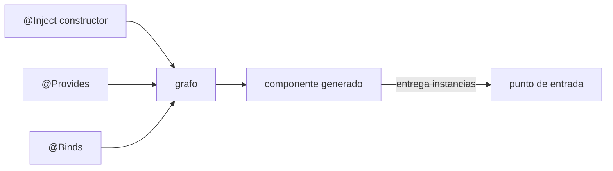
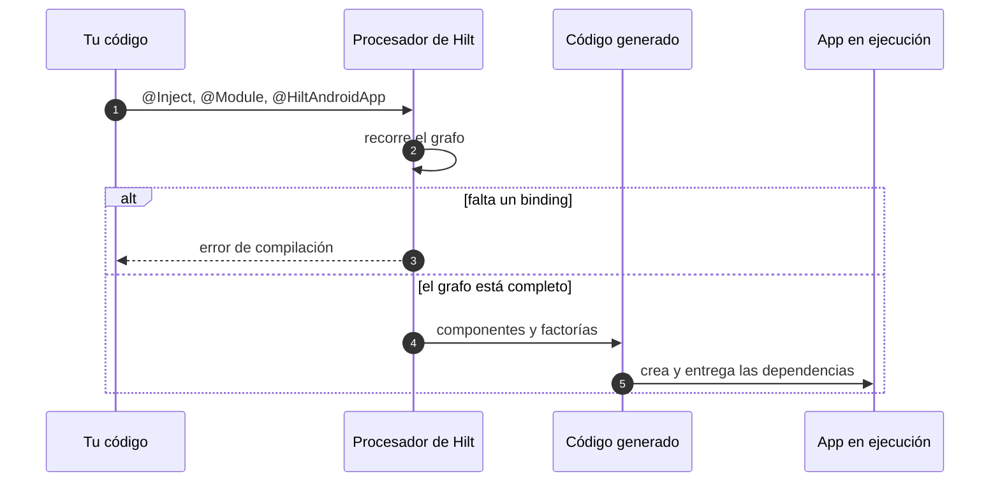

# 1.3 · De DI manual a Dagger: grafo y código generado

## Resumen

> **En una frase:** Dagger escribe por ti el `AppContainer` de la lección 1.2 y comprueba al compilar que el grafo esté completo.

**Resultado esperado:** entender qué genera el compilador y por qué los errores de DI aparecen en el build y no en ejecución.

**Bloques de esta lección**

1. 📖 Binding, grafo y componente → 🛠 leer el contenedor generado → ❓ 2 preguntas
2. 📖 Qué valida KSP al compilar → 🛠 provocar un `MissingBinding` → ❓ 2 preguntas

> [!NOTE]
> Lección en curso. Bloque 1 terminado el 2026-09-15; el bloque 2 queda a mitad: la teoría está leída y la práctica 2 es lo primero de la próxima sesión.

## 📖 Teoría · 1. Binding, grafo y componente

**El problema.** En la lección 1.2 escribiste a mano cómo crear cada objeto. Ese contenedor crece con el proyecto: cada dependencia nueva obliga a tocarlo y nada impide olvidarse de una rama del grafo.

**La idea.** Dagger lee anotaciones y **genera** ese mismo código al compilar. Como el código generado tiene que compilar, un grafo incompleto no llega a ejecutarse: falla el build.

- **Binding:** la regla que dice cómo obtener una instancia de un tipo. Puede ser un constructor con `@Inject`, un método `@Provides` o un `@Binds`.
- **Grafo:** el conjunto de bindings y sus relaciones (qué necesita qué).
- **Componente:** el contenedor generado que expone el grafo y fija el tiempo de vida de lo que tiene scope. Es el equivalente de tu `AppContainer`.

> **Supuesto** (no lo implementes todavía): en este bloque solo leemos código generado. Hilt se configura en la lección 2.1.



**Ejemplo mínimo** (fuera del proyecto)

```kotlin
// Un constructor con @Inject ya es un binding:
// Dagger sabe crear esta clase sin que escribas nada más.
class Greeter @Inject constructor(private val clock: Clock) {
    fun hello() = "Hola, son las ${clock.today()}"
}
```

**En tu proyecto**

```kotlin
// :feature:orders/OfflineFirstOrdersRepository.kt
class OfflineFirstOrdersRepository @Inject constructor(
    private val api: OrdersApi,
    private val dao: OrdersDao,
) : OrdersRepository
```

Tres bindings en una línea de anotación: Dagger aprende a crear `OfflineFirstOrdersRepository` y apunta que necesita `OrdersApi` y `OrdersDao`.

**Lo que sale mal**

Anotar la interfaz en lugar de la implementación. El constructor que Dagger necesita está en la clase concreta:

```text
e: OrdersRepository.kt:7:1 @Inject is not allowed on abstract
   constructors or interfaces
```

La regla práctica: `@Inject` va donde hay un constructor real; las interfaces se enlazan con `@Binds` (lección 2.4).

## 🛠 Práctica · 1. Leer el contenedor que genera Hilt

Usamos una copia del proyecto (`/tmp/orders-hilt-spike`) con Hilt ya configurado, solo para mirar el código generado.

1. Compila la copia: `./gradlew :app:kspDebugKotlin`.
2. Abre `app/build/generated/ksp/debug/java/.../DaggerOrdersApp_HiltComponents_SingletonC.java`.
3. Busca `ordersRepositoryImpl` y compáralo con tu `AppContainer` de 1.2.
4. Anota en el cuaderno una línea generada que te recuerde a tu código.

- **Criterio de éxito:** señalas en el archivo generado el equivalente de tu `by lazy` y el equivalente de tu fábrica de ViewModel.
- **Lo que observaste:** encontraste `DoubleCheck.provider(...)` y lo relacionaste con `by lazy`; la fábrica aparece como `ViewModelProvider.Factory` dentro de `ViewModelCBuilder`. Comentario tuyo: «es mi contenedor pero con nombres peores».

## ❓ Preguntas · 1. Vocabulario del grafo

**P1.** ¿Qué es un binding, con tus palabras? — tu respuesta: *«la instrucción de cómo se crea un tipo»* ✔

<details>
<summary>Respuesta completa</summary>

La regla que le dice a Dagger cómo obtener una instancia de un tipo concreto: un constructor con `@Inject`, un método `@Provides` o un `@Binds`. Sin binding, el tipo no se puede inyectar.

</details>

**Para ampliar:** un binding también puede traer un scope asociado; eso lo vemos en el módulo 3.

**P2.** En el archivo generado, ¿qué parte corresponde a tu `AppContainer` y qué parte a tu `viewModelFactory`? — tu respuesta: *«el SingletonC es el contenedor; la factory está en la parte de ViewModel»* ✔

<details>
<summary>Respuesta completa</summary>

`DaggerOrdersApp_HiltComponents_SingletonC` es el contenedor de aplicación (los `DoubleCheck.provider` son tus `by lazy`). El equivalente de la fábrica vive en el componente de ViewModel, que crea una instancia nueva por pantalla.

</details>

## 📖 Teoría · 2. Qué valida KSP antes de generar

**KSP (Kotlin Symbol Processing)** es la API con la que el procesador de Hilt lee tus anotaciones durante el build. Antes de generar nada, recorre el grafo: parte de cada punto de entrada y comprueba que todo lo que hace falta tenga un binding.



La consecuencia práctica es la que importa: con DI manual, olvidarte de una dependencia se ve en ejecución (la pantalla se cierra); con Dagger se ve en el build, antes de instalar nada.

**Ejemplo mínimo** (fuera del proyecto)

```kotlin
interface Clock { fun today(): String }

// Greeter necesita Clock, pero Clock es una interfaz:
// no hay constructor que anotar, así que falta el binding.
class Greeter @Inject constructor(private val clock: Clock)
```

**En tu proyecto**

`OrdersApi` es una interfaz de Retrofit y `OrdersDao` una interfaz de Room: ninguna tiene constructor propio. Hasta que escribas sus `@Provides`, el grafo de `:feature:orders` está incompleto.

**Lo que sale mal**

Este es el mensaje real al compilar la copia sin `NetworkModule` (una sola línea de la consola, repartida aquí para que quepa):

```text
error: [Dagger/MissingBinding] com.example.orders.OrdersApi cannot
be provided without an @Provides-annotated method.

    com.example.orders.OrdersApi is injected at
        OfflineFirstOrdersRepository(api, …)
    com.example.orders.OrdersRepository is injected at
        OrdersViewModel(repository)
```

Se lee de abajo arriba: quién lo pedía y quién lo pedía antes. La primera línea dice qué falta; las de abajo, desde dónde se llegó a necesitarlo.

## 🛠 Práctica · 2. Provocar y leer un binding faltante

> [!NOTE]
> Pendiente para la próxima sesión. Los pasos están verificados en la copia; la salida de abajo es la que debería aparecerte.

1. En la copia, comenta el método `@Provides` que crea `OrdersApi`.
2. Ejecuta `./gradlew :app:kspDebugKotlin`.
3. Copia la primera línea del error y la cadena de inyección al cuaderno.
4. Descomenta el método y vuelve a compilar.

- **Criterio de éxito:** explicas, señalando la cadena, qué tipo falta y qué clase lo pedía.
- **Lo que observaste:** [[pendiente: se completa en la sesión del 2026-09-17]]

## ❓ Preguntas · 2. Leer errores del grafo

> [!NOTE]
> Pendiente: estas preguntas van después de la práctica 2.

## Fuentes

- [Inyección de dependencias con Hilt](https://developer.android.com/training/dependency-injection/hilt-android) — Android Developers, consultado 2026-09.
- [Dagger: soporte de KSP](https://dagger.dev/dev-guide/ksp) — requisitos y configuración del procesador.
- [Errores habituales de Dagger](https://dagger.dev/dev-guide/compiler-errors) — cómo leer `MissingBinding`.

## Historial

| Fecha | Qué pasó |
|---|---|
| 2026-09-15 | Lección iniciada. Bloque 1 completado (práctica y 2 preguntas correctas). |
| 2026-09-15 | Teoría 2 leída; la sesión se cortó antes de la práctica. Próximo paso: provocar el `MissingBinding`. |
